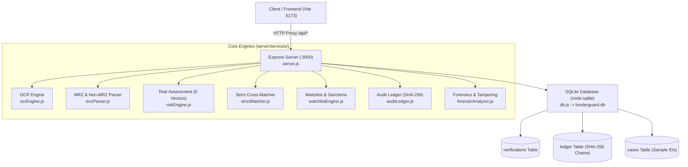

# BorderGuard AI — Backend Documentation & API Reference

Welcome to the **BorderGuard AI Backend**. This backend provides a high-throughput, fault-tolerant REST API, an embedded SQLite database engine with Write-Ahead Logging (WAL), an ICAO 9303 & Non-MRZ Document Extraction Engine, a Multi-Vector Risk Engine, and a SHA-256 Cryptographic Audit Ledger.

---

## 📑 Table of Contents

1. [Architecture Overview](#-architecture-overview)
2. [Directory Structure](#-directory-structure)
3. [Core Services & Documents](#-core-services--documents)
4. [API Reference & Endpoints](#-api-reference--endpoints)
5. [Database Schema (`borderguard.db`)](#-database-schema-borderguarddb)
6. [Cryptographic SHA-256 Ledger](#-cryptographic-sha-256-ledger)
7. [Running & Testing the Backend](#-running--testing-the-backend)

---

## 🏛️ Architecture Overview



---

## 📂 Directory Structure

```text
server/
├── borderguard.db               # SQLite database file (WAL mode)
├── db.js                        # Database layer (Prepared statements & schema)
├── package.json                 # Backend dependencies (express, cors, multer)
├── server.js                    # Main Express REST server & routes
├── uploads/                     # Storage folder for uploaded sample images
├── services/
│   ├── auditLedger.js           # SHA-256 Tamper-Evident Hash Chain
│   ├── forensicAnalyzer.js      # Image tamper & noise detection
│   ├── mrzParser.js             # ICAO 9303 & Indian Non-MRZ Parser
│   ├── ocrEngine.js             # Server-side Tesseract OCR integration
│   ├── riskEngine.js            # Multi-vector risk assessment classifier
│   ├── strictMatcher.js         # Cross-field passenger consistency checks
│   └── watchlistEngine.js       # INTERPOL & Sanctions screening
└── tests/
    ├── test_backend.js          # 53 Automated backend test cases
    ├── test_passport_anushka.js # Passport name/gender/expiry verification
    ├── test_gender_parsing.js   # Multilingual Sex/Gender regex tests
    ├── test_all_dates.js        # Expiry date parsing & OCR repair tests
    ├── test_noisy_extraction.js # Noisy scan extraction tests
    └── test_http_api.js         # HTTP API endpoint tests
```

---

## ⚙️ Core Services & Documents

### 1. `server.js` — Main Express Application
- **File**: `server/server.js`
- **Role**: Initializes Express on port `3000`, configures CORS, sets up `multer` storage for image uploads, and registers all `/api/*` endpoints.

### 2. `db.js` — Database Interface
- **File**: `server/db.js`
- **Role**: Uses native `node:sqlite` `DatabaseSync` in `WAL` mode. Prepares reusable SQL statements for high-speed concurrent inserts and queries.

### 3. `services/mrzParser.js` — Document Extraction Engine
- **File**: `server/services/mrzParser.js`
- **Capabilities**:
  - **MRZ Decoding**: ICAO 9303 TD1 (Identity Cards), TD2 (Visas), TD3 (International Passports) with check-digit validation.
  - **Non-MRZ Parsing**: Indian Passports (Front & Back), Aadhaar (Front & Back), PAN Cards, Voter ID (EPIC), Driving Licenses.
  - **Entity Extraction**: Full Name (`Given Name + Surname`), Gender (`Sex: F`, `लिंग`, `Female`), Date of Birth (`DD/MM/YYYY`, `DD-MMM-YYYY`), Expiry Date, Document Number, and Care Of / Guardian names.

### 4. `services/riskEngine.js` — 6-Vector Risk Assessment
- **File**: `server/services/riskEngine.js`
- **Vectors Evaluated**:
  1. **Biometric Face Match**: Compares facial vector distance.
  2. **Document Integrity & Checksums**: Validates ICAO MRZ hash checks.
  3. **Watchlist & Sanctions Screening**: Checks against blacklists.
  4. **Document Expiration**: Flags expired travel credentials.
  5. **Forensic Tampering**: Detects digital image manipulations.
  6. **Identity Consistency**: Ensures cross-field coherence.
- **Output Levels**:
  - `0 - 24`: **LOW RISK** $\rightarrow$ `Cleared`
  - `25 - 69`: **MEDIUM RISK** $\rightarrow$ `Secondary Inspection`
  - `70 - 100`: **HIGH RISK** $\rightarrow$ `Flagged / Detain`

### 5. `services/auditLedger.js` — SHA-256 Hash Chain
- **File**: `server/services/auditLedger.js`
- **Role**: Creates an append-only cryptographic ledger where every record is hashed with `SHA-256(idx + timestamp + previousHash + dataJson + status)`. Provides a verification function `verifyChainIntegrity(rows)` that detects any database tampering.

---

## 📡 API Reference & Endpoints

### Verification & Risk Decision

#### `POST /api/verify`
Main multi-vector verification endpoint that evaluates documents, face matching, checks watchlists, logs to the database, and commits to the cryptographic ledger.
- **Request Body**:
  ```json
  {
    "extractedDoc": {
      "fullName": "ANUSHKA GHOSH",
      "docType": "Passport (Republic of India)",
      "docNumber": "Z6949313",
      "gender": "Female",
      "dob": "14/09/2004",
      "expiry": "21/06/2035",
      "nationality": "IND",
      "isMrz": false
    },
    "faceMatchScore": 96,
    "officerId": "OFF-7421"
  }
  ```
- **Response**:
  ```json
  {
    "success": true,
    "caseId": "BG-2026-894120",
    "verificationRecord": {
      "riskScore": 3,
      "riskLevel": "LOW",
      "status": "Cleared"
    },
    "ledgerBlock": {
      "index": 12,
      "currentHash": "e3b0c44298fc1c149afbf4c8996fb92427ae41e4649b934ca495991b7852b855",
      "previousHash": "a1b2c3d4e5f6..."
    }
  }
  ```

---

### OCR & Text Parsing

- `POST /api/ocr/extract` — Accepts multipart file upload or `imageBase64` for server-side Tesseract OCR and entity extraction.
- `POST /api/ocr/parse-text` — Directly parses a raw text string into structured fields.

---

### Sample Cases (Demo Database)

- `GET /api/cases` — Lists all registered demo ID cases.
- `POST /api/cases` — Uploads an ID image with `name`, `label` (`genuine` | `fake`), and `notes`.
- `DELETE /api/cases/:id` — Deletes a case and its uploaded image file.

---

### Cryptographic Audit Trail

- `GET /api/audit-trail` — Returns the full blockchain ledger and tests chain integrity.
- `POST /api/audit-trail/verify` — Validates all cryptographic hash pointers.
- `DELETE /api/audit-trail` — Resets the audit ledger to Genesis state.

---

### Watchlist & Screening

- `GET /api/watchlist` — Returns the list of active sanctions & watchlists.
- `POST /api/watchlist/check` — Screens a person by `name`, `docNumber`, or `nationality`.

---

### System Diagnostics

- `GET /api/system/health` — Returns backend health, uptime, SQLite database size, and active engine statuses.
- `GET /api/analytics/stats` — Returns aggregate inspection statistics.

---

## 🗄️ Database Schema (`borderguard.db`)

```sql
-- Sample Cases
CREATE TABLE cases (
  id INTEGER PRIMARY KEY AUTOINCREMENT,
  name TEXT NOT NULL,
  label TEXT NOT NULL CHECK (label IN ('genuine', 'fake')),
  notes TEXT DEFAULT '',
  image_filename TEXT NOT NULL,
  created_at TEXT NOT NULL DEFAULT (datetime('now'))
);

-- Cryptographic Audit Ledger
CREATE TABLE ledger (
  idx INTEGER PRIMARY KEY AUTOINCREMENT,
  timestamp TEXT NOT NULL,
  previous_hash TEXT NOT NULL,
  current_hash TEXT NOT NULL,
  status TEXT NOT NULL,
  case_id INTEGER,
  data_json TEXT NOT NULL,
  FOREIGN KEY (case_id) REFERENCES cases(id) ON DELETE SET NULL
);

-- Verification History
CREATE TABLE verifications (
  id INTEGER PRIMARY KEY AUTOINCREMENT,
  case_id TEXT UNIQUE NOT NULL,
  time TEXT NOT NULL,
  doc_type TEXT,
  country TEXT,
  name TEXT,
  dob TEXT,
  gender TEXT,
  care_of TEXT,
  doc_number TEXT,
  vid_number TEXT,
  address TEXT,
  nationality TEXT,
  expiry TEXT,
  mrz TEXT,
  risk_score INTEGER DEFAULT 0,
  risk_level TEXT DEFAULT 'LOW',
  status TEXT DEFAULT 'Cleared',
  doc_integrity INTEGER DEFAULT 95,
  face_match INTEGER DEFAULT 90,
  identity_consistency INTEGER DEFAULT 95,
  reasons_json TEXT DEFAULT '[]',
  full_record_json TEXT,
  created_at TEXT NOT NULL DEFAULT (datetime('now'))
);
```

---

## 🧪 Running & Testing the Backend

### Start the Server
```bash
cd server
node server.js
# Output: [BorderGuard AI Backend] Secure audit server active on port 3000
```

### Run All 53 Automated Tests
```bash
cd server
node test_backend.js
```
